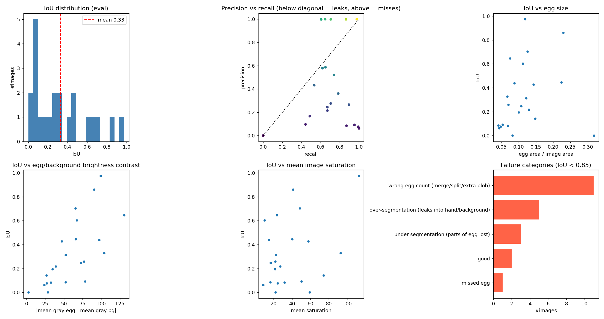
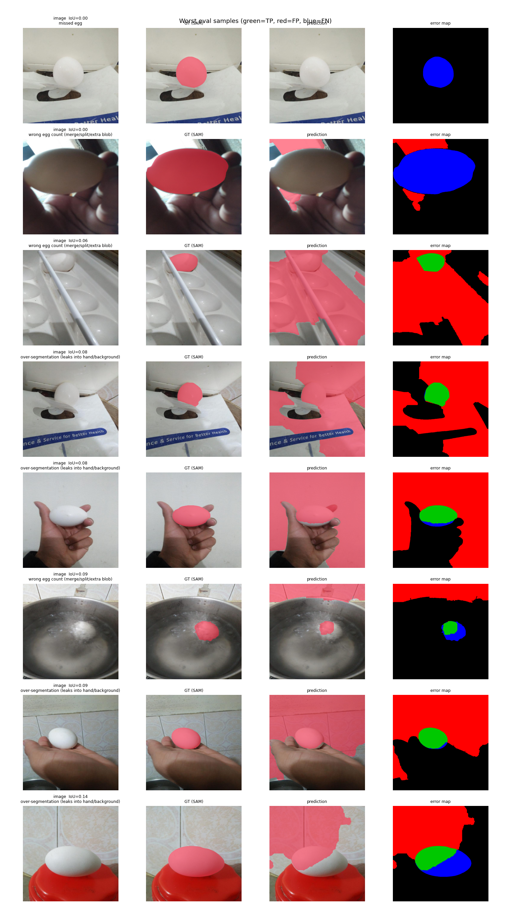
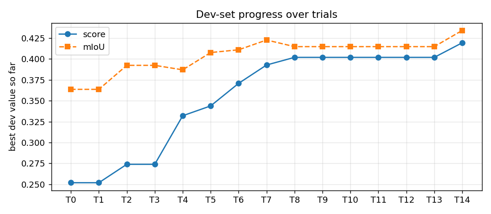

# Egg segmentation: classical image processing vs SAM ground truth

## 1. Setup
- 110 images, split by **group** into dev (88) / eval (22) = 4:1 (seed 42).
  Groups = same base filename (augmentation suffix removed) OR perceptual-hash distance <= 10 under any flip/rotation;
  the original train/valid/test folders were merged first because they can contain augmented copies of the same photo.
  Nearest dev<->eval Hamming distance: 13.
- Ground truth = Task 1 masks (Grounding-DINO + SAM). Predictions = final classical pipeline.
- Final configuration: `{"method": "hsv", "blur": 0.01, "s_scale": 0.6, "v_scale": 1.15, "canny_sigma": 0.33, "open": 0.03, "close": 0.06, "fill": true, "min_area": 0.01, "max_area": 0.9, "solidity": 0.0, "convex": false, "watershed": false, "ws_frac": 0.5, "grabcut": true}`
- All tuning used the dev set only; eval numbers below were computed once at the end.

## 2. Quantitative results
| subset | n_images | mIoU | mDice | mPrec | mRec | inst_F1 | count_acc | pixel_acc | IoU_median | IoU_std |
|---|---|---|---|---|---|---|---|---|---|---|
| dev | 88 | 0.434 | 0.548 | 0.534 | 0.745 | 0.405 | 0.523 | 0.789 | 0.337 | 0.290 |
| eval | 22 | 0.327 | 0.434 | 0.411 | 0.673 | 0.344 | 0.455 | 0.760 | 0.252 | 0.281 |

Metrics: IoU / Dice / precision / recall / pixel accuracy are per image (averaged); `inst_F1` = instance-level F1 with
Hungarian matching at IoU>=0.5; `count_acc` = fraction of images whose number of eggs is exactly right.

Key numbers on the eval set:
- mean IoU 0.327, median 0.252; 4.5% of images have IoU >= 0.9 and 77.3% have IoU < 0.5.
- mean precision 0.411 vs mean recall 0.673 -> the method tends to over-segment (include extra pixels).
- Spearman correlation of IoU with: egg size +0.39, egg/background contrast +0.76, image brightness -0.45, saturation +0.19.

## 3. Failure analysis (eval images with IoU < 0.85: 20 of 22)
| failure type | #images |
|---|---|
| wrong egg count (merge/split/extra blob) | 11 |
| over-segmentation (leaks into hand/background) | 5 |
| under-segmentation (parts of egg lost) | 3 |
| missed egg | 1 |

Reading the error maps: red = pixels the classical method added that SAM did not (leakage into hand/background/shadow),
blue = egg pixels the classical method missed (shadowed side, specular highlight, shell spots).

**What goes wrong (check against your plots and edit):**
1. Global colour/brightness thresholds cannot separate the egg from bright or low-saturation neighbours (skin highlights, white cloth, glare) -> leakage (red).
2. Shadowed or glossy parts of the egg fall outside the brightness/saturation range -> missing pixels (blue); hull/closing only partially fixes this.
3. Touching or overlapping eggs form one component -> wrong counts and low instance F1 unless watershed splits them correctly.
4. Per-image Otsu fails when the egg occupies a very small or very large share of the image (bimodal assumption breaks).
5. Brown / coloured eggs violate the "egg = bright & colourless" assumption.

## 4. Ideas for improvement
- Local / adaptive thresholds or a per-image 2-3 cluster k-means in Lab, picking the cluster that is most egg-like (convex, ellipse-like).
- Ellipse fitting (RANSAC / Hough) on edges to impose the egg shape prior; reject candidates with poor elliptical fit.
- Colour-model refinement (GrabCut / GMM) seeded from the confident core of the mask.
- Illumination normalisation (CLAHE, shadow removal) before thresholding.
- Better touching-egg splitting (distance-transform peaks + ellipse fit); trained pixel classifier (random forest on colour/texture features) as a stronger-but-still-classical alternative.

## Experiment log (dev set only)

Selection rule: a change is kept only if it raises the dev score = 0.5*(mIoU + instance-F1) by >= 0.002; every trial starts from the best configuration so far. Parameters like kernel sizes are fractions of the image's shorter side.

| trial | name | what_changed | why_tried | mIoU | mDice | inst_F1 | decision | reason |
|---|---|---|---|---|---|---|---|---|
| T0 | Baseline: gray + Otsu | {"(none)": "baseline"} | Simplest thing possible: eggs are usually brighter than their surroundings. | 0.364 | 0.479 | 0.140 | KEEP | baseline |
| T1 | Edge based: Canny + close + fill contours | {"method": "canny"} | Assignment hint: try edge detection first. Egg outline is a clean closed ellipse, so filling closed edge loops should work. | 0.111 | 0.146 | 0.086 | DISCARD | dev score 0.099 vs 0.252 (-0.153); gain < 0.002; mIoU 0.111, inst_F1 0.086 |
| T2 | HSV: low saturation & high value | {"method": "hsv"} | White eggs are bright and colourless, whereas skin / wood / cloth backgrounds are coloured; gray-only Otsu ignores that. | 0.392 | 0.508 | 0.155 | KEEP | dev score 0.274 vs 0.252 (+0.022); mIoU 0.392, inst_F1 0.155 |
| T3 | Lab: low chroma & high lightness | {"method": "lab"} | Lab separates lightness from colour more perceptually uniformly than HSV; may be more robust to lighting. | 0.373 | 0.484 | 0.077 | DISCARD | dev score 0.225 vs 0.274 (-0.049); gain < 0.002; mIoU 0.373, inst_F1 0.077 |
| T4 | Morphology: open 0.01 + close 0.02 + fill holes | {"open": 0.01, "close": 0.02, "fill": true} | Raw thresholds leave speckle and holes from specular highlights / egg-shell spots. | 0.387 | 0.501 | 0.277 | KEEP | dev score 0.332 vs 0.274 (+0.058); mIoU 0.387, inst_F1 0.277 |
| T5 | Aggressive morphology: open 0.03 + close 0.06 | {"open": 0.03, "close": 0.06} | Check whether more smoothing keeps helping or starts to distort shapes / merge objects. | 0.408 | 0.524 | 0.280 | KEEP | dev score 0.344 vs 0.332 (+0.012); mIoU 0.408, inst_F1 0.280 |
| T6 | Min component area 0.01 | {"min_area": 0.01} | Small false blobs (bright spots in background) hurt precision and instance counts. | 0.411 | 0.527 | 0.331 | KEEP | dev score 0.371 vs 0.344 (+0.027); mIoU 0.411, inst_F1 0.331 |
| T7 | Sweep saturation threshold scale | {"s_scale": 0.6} | Otsu is only a heuristic split; scaling it up/down adjusts how much slightly-coloured shell/shadow is included. | 0.423 | 0.538 | 0.363 | KEEP | dev score 0.393 vs 0.371 (+0.022); mIoU 0.423, inst_F1 0.363 |
| T7 | Sweep saturation threshold scale | {"s_scale": 0.8} | Otsu is only a heuristic split; scaling it up/down adjusts how much slightly-coloured shell/shadow is included. | 0.424 | 0.538 | 0.351 | DISCARD | worse sweep point than the best one in this sweep |
| T7 | Sweep saturation threshold scale | {"s_scale": 1.0} | Otsu is only a heuristic split; scaling it up/down adjusts how much slightly-coloured shell/shadow is included. | 0.411 | 0.527 | 0.331 | DISCARD | worse sweep point than the best one in this sweep |
| T7 | Sweep saturation threshold scale | {"s_scale": 1.2} | Otsu is only a heuristic split; scaling it up/down adjusts how much slightly-coloured shell/shadow is included. | 0.396 | 0.513 | 0.323 | DISCARD | worse sweep point than the best one in this sweep |
| T7 | Sweep saturation threshold scale | {"s_scale": 1.5} | Otsu is only a heuristic split; scaling it up/down adjusts how much slightly-coloured shell/shadow is included. | 0.375 | 0.492 | 0.275 | DISCARD | worse sweep point than the best one in this sweep |
| T8 | Sweep value/lightness threshold scale | {"v_scale": 0.5} | Same idea for brightness; shadowed side of the egg is darker. | 0.348 | 0.457 | 0.240 | DISCARD | worse sweep point than the best one in this sweep |
| T8 | Sweep value/lightness threshold scale | {"v_scale": 0.7} | Same idea for brightness; shadowed side of the egg is darker. | 0.370 | 0.480 | 0.261 | DISCARD | worse sweep point than the best one in this sweep |
| T8 | Sweep value/lightness threshold scale | {"v_scale": 0.85} | Same idea for brightness; shadowed side of the egg is darker. | 0.401 | 0.514 | 0.295 | DISCARD | worse sweep point than the best one in this sweep |
| T8 | Sweep value/lightness threshold scale | {"v_scale": 1.0} | Same idea for brightness; shadowed side of the egg is darker. | 0.423 | 0.538 | 0.363 | DISCARD | worse sweep point than the best one in this sweep |
| T8 | Sweep value/lightness threshold scale | {"v_scale": 1.15} | Same idea for brightness; shadowed side of the egg is darker. | 0.415 | 0.534 | 0.389 | KEEP | dev score 0.402 vs 0.393 (+0.009); mIoU 0.415, inst_F1 0.389 |
| T9 | Convex hull per egg | {"convex": true} | Eggs are convex; hull repairs dents caused by shadows and highlights. | 0.407 | 0.527 | 0.389 | DISCARD | dev score 0.398 vs 0.402 (-0.004); gain < 0.002; mIoU 0.407, inst_F1 0.389 |
| T10 | Solidity filter >= 0.85 | {"solidity": 0.85} | Non-egg blobs (fingers, cloth folds) are typically non-convex. | 0.294 | 0.364 | 0.449 | DISCARD | dev score 0.372 vs 0.402 (-0.030); gain < 0.002; mIoU 0.294, inst_F1 0.449 |
| T11 | Larger blur (0.03) | {"blur": 0.03} | Stronger smoothing could suppress texture before thresholding. | 0.403 | 0.524 | 0.371 | DISCARD | dev score 0.387 vs 0.402 (-0.015); gain < 0.002; mIoU 0.403, inst_F1 0.371 |
| T12 | Watershed split of touching eggs (ws_frac 0.5) | {"watershed": true, "ws_frac": 0.5} | Touching eggs form one component, which hurts the instance count / instance F1. | 0.397 | 0.515 | 0.336 | DISCARD | dev score 0.366 vs 0.402 (-0.036); gain < 0.002; mIoU 0.397, inst_F1 0.336 |
| T13 | Watershed split, stricter seeds (ws_frac 0.7) | {"watershed": true, "ws_frac": 0.7} | ws_frac 0.5 may over-split single eggs; stricter seeds are more conservative. | 0.370 | 0.480 | 0.352 | DISCARD | dev score 0.361 vs 0.402 (-0.041); gain < 0.002; mIoU 0.370, inst_F1 0.352 |
| T14 | GrabCut boundary refinement | {"grabcut": true} | Colour-model based refinement of the boundary should recover the true egg edge. | 0.434 | 0.548 | 0.405 | KEEP | dev score 0.419 vs 0.402 (+0.017); mIoU 0.434, inst_F1 0.405 |

**Final configuration:** `{"method": "hsv", "blur": 0.01, "s_scale": 0.6, "v_scale": 1.15, "canny_sigma": 0.33, "open": 0.03, "close": 0.06, "fill": true, "min_area": 0.01, "max_area": 0.9, "solidity": 0.0, "convex": false, "watershed": false, "ws_frac": 0.5, "grabcut": true}`

